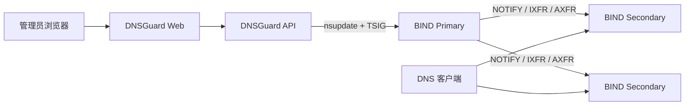

# DNSGuard · 域盾

**让每一次解析，都有安全边界。**

<p align="center"></p>

DNSGuard 是 BIND RPZ 的轻量级 Web 控制面。它管理白名单、A 重定向、发布任务和审计记录，再通过 `nsupdate + TSIG` 更新 BIND Primary。BIND 继续负责递归解析以及 Primary/Secondary 同步。

DNSGuard 不替代 BIND、不参与客户端 DNS 查询，也不会自动修改或重启生产 BIND。

## 核心能力

| 能力 | 说明 |
|---|---|
| 白名单与重定向 | PASSTHRU 白名单、多级子域名放行、A 记录重定向 |
| 全局默认 DENY | 独立 `global-deny.rpz.local`；白名单和重定向优先 |
| 安全发布 | 草稿审核、`nsupdate + TSIG`、SOA/Secondary 同步核验 |
| 可靠性保护 | `pending_verification`、`reconcile_required`、人工核对和版本回滚 |
| 安全运维 | 登录、CSRF、审计哈希链、JSON 持久化、备份恢复 |

## 架构



生产 Compose 只运行 `dnsguard-api` 和 `dnsguard-web`；BIND 集群由管理员独立部署。

## 环境要求

- Docker Engine 24+ 和 Docker Compose Plugin 2.20+。
- 已运行的 BIND Primary、至少一台 Secondary，以及管理员准备的 RPZ、TSIG 和 HTTPS 证书。
- DNSGuard API 能访问 BIND 的 DNS、SOA 和必要的 AXFR 路径。
- 不需要在 DNSGuard 主机安装 Go、Node.js、npm 或 BIND。

安装前请确认当前安装用户可以执行 `docker info`，而不只是读取
`docker compose version`；Docker Socket 权限应由管理员预先配置，安装器不会修改用户组或放宽 Socket 权限。
同时准备可读取的已有 BIND TSIG Key、HTTPS 证书和私钥。测试环境必须先准备业务 RPZ
以及独立的 `global-deny.rpz.local` Zone，并在启用 DENY 前准备一个确实能正常解析的递归基线域名。
DNSGuard 只负责控制面和 `nsupdate + TSIG` 发布，不代替管理员配置生产 BIND、`response-policy`
或 Primary/Secondary 同步。

## 快速开始

### 1. 部署前准备 BIND

请由 BIND 管理员先完成：

1. 准备白名单/A 重定向 RPZ Zone、动态更新 TSIG、NOTIFY 和 IXFR/AXFR。
2. 将白名单/A 重定向 Zone 放在 `response-policy` 的较高优先级。
3. 如使用全局 DENY，预先创建 `global-deny.rpz.local`，但首次上线先不要把它加入递归 `response-policy`。
4. 准备一个启用 DENY 前确实能够正常解析的测试域名，用于递归基线检查。

DNSGuard 不安装或配置生产 BIND。具体 BIND 准备要求见[BIND RPZ 对接文档](docs/bind-rpz-deployment.md)。

### 2. 获取 v1.1.1 并启动控制面

先克隆仓库，再运行仓库内安装入口：

```bash
git clone --branch v1.1.1 --single-branch \
  https://github.com/Bl4ckB1t7/dnsguard.git dnsguard
cd dnsguard
./install.sh
```

无人值守执行时，必须预先提供 `RPZ_PRIMARY`、`RPZ_GLOBAL_DENY_RECURSOR`、
`RPZ_GLOBAL_DENY_CHECK_NAME`、`RPZ_TSIG_SOURCE`、`TLS_CERT_SOURCE` 和
`TLS_KEY_SOURCE`，或通过 `DNSGUARD_ENV_FILE` 指向受保护的配置文件；缺少项会明确报错，
不会静默生成半成品环境文件。

首次尚未存在 `deploy/docker/dnsguard.env` 时，安装脚本会检查 Docker/Compose，准备目录，生成运行密钥和一次性 Bootstrap Token，并提示提供已有 BIND TSIG Key、HTTPS 证书和私钥。若已存在环境文件，则必须先填入真实安全参数。脚本不会生成或替换生产 TSIG Key，也不会生成不可信的自签名证书；缺少必要文件时会停止。

如果 BIND 在另一套已经存在的 Docker 网络中，先设置网络名再安装：

```bash
export DNSGUARD_BIND_NETWORK=existing-bind-network
./install.sh
```

安装会检查该外部网络及其实际 Subnet 是否被 `DNS_NODE_ALLOWED_CIDRS` 明确授权，不会创建网络或自动放宽 CIDR。API 使用该网络中 BIND 可达的地址和 `53` 端口；宿主机映射端口不能填入容器配置。普通物理机/虚拟机 BIND 不设置此变量。

Bootstrap Token 不会打印到普通日志。默认安装后在仓库根目录用受保护终端读取：

```bash
sudo cat ./secrets/bootstrap.token
```

如果设置了 `DNSGUARD_SECRET_DIR`，读取该自定义目录下的 `bootstrap.token`；安装脚本最后输出的实际路径优先。不要把 Token 放进聊天、截图或工单。重复执行安装不会覆盖现有配置、密钥、Token 或数据。

### 3. 首次上线顺序

打开安装输出的 HTTPS 地址，按以下顺序操作：

1. 完成 Web 初始化，连接 BIND Primary/Secondary 并完成只读检查。
2. 在 RPZ 规则页面导入 TXT（每行一个域名）或白名单 JSON，审核后保存为 `draft`。
3. 人工确认并发布白名单/A 重定向，等待 Primary 和所有 Secondary 验证成功。
4. 由 BIND 管理员把预先准备的 `global-deny.rpz.local` 加入 `response-policy`。
5. 由 BIND 管理员完成配置并 reload 后，运行 `./scripts/finalize-global-deny.sh`；脚本会只读核对 BIND、原子关闭临时配置并使用现有镜像重建 API。
6. 回到 Web 执行只读核验，确认白名单、多级子域名、A 重定向和未知域名的实际递归结果。

普通 BIND 使用：

```bash
docker compose --env-file deploy/docker/dnsguard.env \
  -f compose.yaml up -d --force-recreate
```

如果设置了 `DNSGUARD_BIND_NETWORK`，收尾脚本和手工重建都必须保留外部网络 override：

```bash
export DNSGUARD_BIND_NETWORK=existing-bind-network
docker compose --env-file deploy/docker/dnsguard.env \
  -f compose.yaml -f compose.bind-network.yaml up -d --force-recreate
```

收尾脚本不会修改或 reload BIND，也不会重新构建镜像；失败时会保留 env 保护备份并给出恢复提示。

首次安装使用 deferred 只是为了先完成初始化和白名单发布，不是长期运行模式。完成初始化后仍保留该变量，API 会拒绝启动。

完成真实发布、节点同步和全局 DENY 只读核验后，首次部署引导会完全消失。之后新增 `draft` 或 Secondary 暂时离线不会重新打开引导；这些状态仍在规则和节点页面显示。

## 安全边界

- DNSGuard 仅通过 `nsupdate + TSIG` 更新管理员预先配置的 RPZ Zone，不修改 `named.conf`、`response-policy` 或生产 Zone 文件。
- 客户端收到 `NXDOMAIN` 不等于完整 QNAME 没有到达上游。
- 隔离测试中部分 DNSSEC `DO=1` 查询仍可能到达上游；上线前必须按目标 BIND 配置单独验证。
- 全局 DENY 不应被宣传为所有查询类型和 DNSSEC 场景下百分之百阻断 DNS 隧道。
- 不要把生产 TSIG、Bootstrap Token、HTTPS 私钥或真实业务数据提交到 Git。

## 两套 Zone 的名称

- `global-deny.rpz.local`：v1.1.0+ 的全局默认 DENY Zone，不依赖 IANA TLD 列表。
- `tld-deny.rpz.local`：v1.0.1 的旧 TLD 兼容路径，升级时保留历史数据，但不是 v1.1.1 全局 DENY 的必要依赖。

## 界面预览

| 登录页 | DNS 控制台 |
|---|---|
|  |  |

## 文档

- [Docker 安装与初始化](deploy/docker/README.md)
- [高级运维：备份、恢复、升级和迁移](docs/docker-operations.md)
- [BIND RPZ 部署与对接](docs/bind-rpz-deployment.md)
- [v1.1.0 隔离验收](docs/acceptance/v1.1.0-first-deployment-acceptance.md)
- [DNS 隧道重新验收](docs/acceptance/v1.1.0-dns-tunnel-retest.md)
- [v1.0.1 正式验收](docs/acceptance/v1.0.1-bind-acceptance.md)
- [安全说明](SECURITY.md) · [发布说明](RELEASE_NOTES.md) · [许可证](LICENSE)

## License

MIT License
