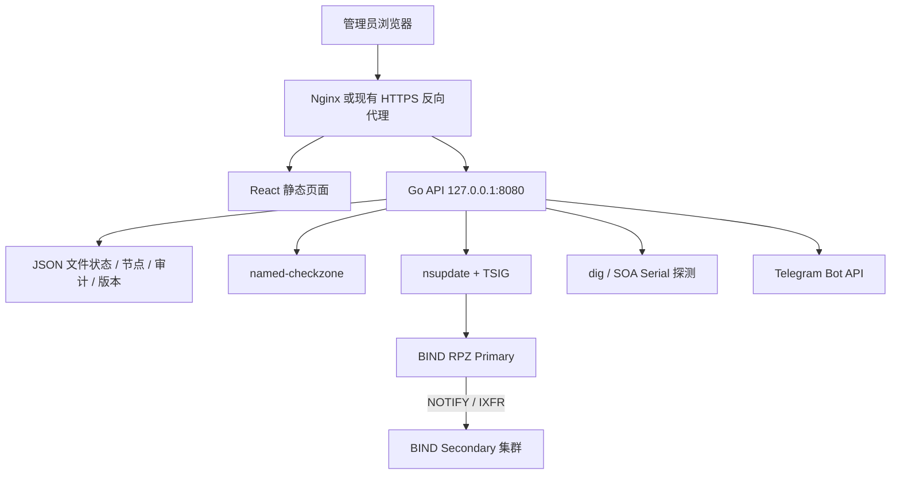

# 域盾（DNSGuard）

域盾（DNSGuard）是面向企业 DNS 运维的轻量控制面，负责 RPZ 规则管理、发布、节点状态、审计、版本回滚和告警配置。BIND 仍然是 DNS 查询和 RPZ 执行的数据面，域盾不接管 DNS 查询，也不需要数据库。

## 先看这里

- **生产部署使用安装脚本和 systemd**，不要用开发启动脚本长期运行。
- **不使用数据库**：规则、节点、版本、审计和运行状态使用受保护的 JSON 文件保存。
- **生产默认通过 `nsupdate + TSIG` 更新 RPZ Primary**，由 BIND 原生 NOTIFY/IXFR 同步 Secondary。
- **发布成功必须通过集群核验**：Primary SOA Serial、全部 Secondary SOA Serial，以及关键 RPZ 规则的精确和泛域名响应都验证通过后，任务才会标记成功。
- **发布任务可恢复**：任务快照保存在 JSON 文件中；API 重启时未完成任务会进入 `reconcile_required`，不会未经核对自动重放或自动回滚。
- **故障优先保护 DNS 数据面**：DNSGuard 只负责控制面，发布失败、API 重启或控制面宕机不会停止 BIND 已加载的解析服务。
- **API 默认只监听 `127.0.0.1:8080`**，生产通过 Nginx 或现有 HTTPS 反向代理提供页面访问。
- **发布不是自动发生的**：新增、编辑或删除规则后，必须在页面点击“生成 / 发布 RPZ”。没有待发布变更时，发布按钮会显示“已是最新”。
- 本地 BIND/RPZ 联调环境保留在 `dev/bind-rpz/`，只监听 `5353`，不会占用生产 DNS 的 `53` 端口。

## 解决什么问题

企业中手工维护 BIND RPZ 通常会遇到：

- 修改 Zone 文件容易出现格式错误、漏改或误删。
- 修改后需要手工 reload/restart，发布过程缺少统一状态。
- Primary、Secondary 的 RPZ Serial 和健康状态分散，故障发现不及时。
- 多人操作缺少原因、操作者、来源地址和可检索的审计记录。
- 误操作后只能依赖文件备份，回滚步骤不清晰。
- 引入数据库、消息队列和多个微服务后，部署和维护成本过高。

域盾的目标是把这些操作集中到一个可回滚、可审计、文件可读的控制面，同时不改变 BIND 的稳定数据面。

## 功能概览

- RPZ 白名单：CNAME `rpz-passthru` 动作。
- RPZ A 记录重定向：将域名和泛域名触发器指向指定 IPv4。
- 发布预览：显示当前规则、已发布规则和待处理变更。
- 受控发布：内置规则校验、`named-checkzone` 校验、`nsupdate` 发布、任务持久化和 Primary/Secondary 集群核验。
- 故障恢复保护：状态写入失败回滚内存快照；状态文件和备份同时损坏时拒绝启动；失败发布保留诊断，不自动回滚。
- 版本记录：保存发布版本，支持回滚并重新发布。
- DNS 节点管理：增加、编辑、删除节点，角色固定为主节点或辅节点。
- 真实节点状态：通过 `dig` 查询节点 SOA Serial，显示正常、版本不一致或不可达。
- 当前 RPZ 记录：读取配置的 BIND RPZ 日志并进行去重统计。
- 审计日志：支持搜索、分页、规则详情展开和哈希链校验状态。
- 告警配置：前端配置 Telegram Bot、Chat ID、告警事件和冷却时间。
- 认证能力：验证码、登录限速、CSRF、Cookie 会话、首次登录改密和主动改密。
- 备份恢复：对状态、节点、审计和 RPZ 产物进行带 SHA-256 清单的备份和恢复。

## 架构



推荐部署在独立管理节点，不要求控制面和 BIND Primary 在同一台服务器。控制面至少需要：

- 到 Primary 的 DNS 动态更新端口和 SOA 查询连通性。
- 到全部 Secondary 的 DNS SOA 查询连通性。
- 能读取 RPZ 动态更新使用的 TSIG key。
- 管理员能通过管理网段访问 HTTPS 页面。

## 生产部署

### 前置条件

以下以 Debian/Ubuntu 为例：

```bash
sudo apt-get update
sudo apt-get install -y git curl nodejs npm golang bind9-utils bind9-dnsutils
```

确认依赖：

```bash
node --version
npm --version
go version
dig -v
nsupdate -h >/dev/null
named-checkzone -h >/dev/null
systemctl --version
```

准备信息：

| 信息 | 示例 | 用途 |
|---|---|---|
| RPZ Primary | `DNS_PRIMARY:53` | 动态更新目标 |
| Secondary 列表 | `DNS_SECONDARY_1:53,DNS_SECONDARY_2:53` | 节点状态和同步验证 |
| TSIG key 文件 | `PATH_TO_RPZ_KEY` | `nsupdate` 认证 |
| RPZ 日志文件 | `/var/log/named/rpz.log` | RPZ 命中统计 |
| 管理网卡 | `BIND_INTERFACE` | Web 绑定地址来源 |
| HTTPS 域名 | `DNSGUARD_DOMAIN` | Nginx `server_name` |

### 一键安装和配置

从 GitHub 获取代码：

```bash
git clone https://github.com/Bl4ckB1t7/dnsguard.git dnsguard
cd dnsguard
```

执行安装脚本：

```bash
sudo ./scripts/install-dnsguard.sh
```

安装脚本会完成：

1. 创建 `dnsguard` 系统用户和用户组。
2. 将程序安装到 `/opt/dnsguard`。
3. 创建 `/etc/dnsguard`、`/var/lib/dnsguard` 和 `/var/log/dnsguard`。
4. 从 root-owned 发布目录构建 React 前端和 Go API，构建完成后服务用户不能修改安装目录中的代码。
5. 安装 `dnsguard-api.service`、`dnsguard-monitor.service` 和定时器。
6. 设置服务最小权限；服务用户只写入 `/var/lib/dnsguard` 和 `/var/log/dnsguard` 等运行目录。

执行交互式配置：

```bash
sudo ./scripts/setup-dnsguard.sh
```

配置脚本会询问：

1. Primary 地址，格式为 `HOST:PORT`。
2. Secondary 地址，多个地址使用逗号分隔。
3. TSIG key 源文件路径。
4. BIND RPZ 日志文件路径，多个文件使用逗号分隔。
5. 管理网卡名称。
6. Web 绑定地址，可留空并自动读取管理网卡 IPv4。
7. 登录用户名，默认是 `admin`。

配置脚本会自动生成：

- `/etc/dnsguard/dnsguard.env`：唯一运行配置。
- `/etc/dnsguard/dns-nodes.json`：DNS 节点配置。
- `/etc/dnsguard/keys/rpz-manager.key`：服务使用的受保护 TSIG key 副本。
- `/etc/dnsguard/auth.json`：bcrypt 密码哈希文件，不保存明文密码。
- `/var/lib/dnsguard/`：规则状态、版本、审计和 RPZ 产物。

如果认证文件不存在，配置脚本会交互式要求输入初始密码。密码不会写入 `dnsguard.env`。
如果重复运行配置脚本，已有的 `AUTH_SECRET` 和 `MONITORING_TOKEN` 会保留，不会无故导致所有会话失效。

完成后执行生产预检查：

```bash
sudo /opt/dnsguard/scripts/preflight-dnsguard.sh
```

预检查会验证：

- 生产模式和认证是否开启。
- 会话密钥和监控 Token 长度是否足够。
- bcrypt 认证文件和节点 JSON 是否有效。
- 所有 DNS 节点是否能通过 `dig` 查询。
- `nsupdate` 模式下 TSIG key 和 Primary SOA 是否可用。
- HTTPS 证书或可信反向代理配置是否满足要求。

启动服务：

```bash
sudo systemctl enable --now dnsguard-api.service
sudo systemctl enable --now dnsguard-monitor.timer
sudo systemctl status dnsguard-api.service --no-pager
sudo systemctl list-timers dnsguard-monitor.timer --no-pager
```

### 无人值守配置

已准备好全部参数时，可以使用环境变量：

```bash
sudo env DNSGUARD_NONINTERACTIVE=true \
  DNSGUARD_PRIMARY_ADDRESS=DNS_PRIMARY:53 \
  DNSGUARD_SECONDARY_ADDRESSES=DNS_SECONDARY_1:53,DNS_SECONDARY_2:53 \
  DNSGUARD_RPZ_KEY_FILE=PATH_TO_RPZ_KEY \
  DNSGUARD_RPZ_LOG_FILES=/var/log/named/rpz.log \
  DNSGUARD_BIND_INTERFACE=BIND_INTERFACE \
  DNSGUARD_AUTH_USERNAME=admin \
  ./scripts/setup-dnsguard.sh
```

无人值守模式不会绕过预检查。TSIG key、节点连通性或 HTTPS 配置不满足条件时，脚本会失败并给出原因。

### Nginx 反向代理

生产推荐由 Nginx 终止 HTTPS，API 只保持回环监听：

```bash
sudo install -m 0644 deploy/nginx/dnsguard.conf \
  /etc/nginx/sites-available/dnsguard.conf
```

编辑文件，将：

- `DNSGUARD_DOMAIN` 替换为实际管理域名。
- `/etc/dnsguard/tls/fullchain.pem` 替换为证书路径。
- `/etc/dnsguard/tls/privkey.pem` 替换为私钥路径。
- Nginx 管理访问控制按现场网段补充。

启用并检查：

```bash
sudo ln -sf /etc/nginx/sites-available/dnsguard.conf \
  /etc/nginx/sites-enabled/dnsguard.conf
sudo nginx -t
sudo systemctl reload nginx
```

Nginx 托管 `/opt/dnsguard/dist`，将 `/api/` 代理到 `127.0.0.1:8080`。启用 Nginx 后不要再使用 Vite Preview 对外提供生产页面。

### HTTPS 配置选择

默认 setup 使用可信反向代理模式：

```dotenv
TRUST_PROXY_TLS=true
TLS_CERT_FILE=
TLS_KEY_FILE=
```

如果不使用反向代理，由 Go API 直接提供 HTTPS，需要在 `/etc/dnsguard/dnsguard.env` 设置：

```dotenv
TRUST_PROXY_TLS=false
TLS_CERT_FILE=PATH_TO_TLS_CERT
TLS_KEY_FILE=PATH_TO_TLS_KEY
```

修改后重新执行：

```bash
sudo /opt/dnsguard/scripts/preflight-dnsguard.sh
sudo systemctl restart dnsguard-api.service
```

## 日常运维

### 更新版本

生产更新建议先备份，再使用主分支的最新代码重新构建：

```bash
cd PATH_TO_DNSGUARD
git fetch origin
git checkout main
git pull --ff-only
sudo ./scripts/backup-dnsguard.sh
sudo ./scripts/install-dnsguard.sh
sudo /opt/dnsguard/scripts/preflight-dnsguard.sh
sudo systemctl restart dnsguard-api.service
```

如果配置文件已经存在，安装脚本不会覆盖 `/etc/dnsguard/dnsguard.env`；需要变更 DNS 节点或 TSIG key 时，再运行：

```bash
sudo ./scripts/setup-dnsguard.sh
```

### RPZ 变更流程

```text
新增/编辑/删除规则
        ↓
保存为待发布状态
        ↓
查看发布预览
        ↓
生成 RPZ 并执行 named-checkzone
        ↓
nsupdate 更新 Primary
        ↓
BIND NOTIFY / IXFR 同步 Secondary
        ↓
逐台 dig 查询各节点 SOA Serial
        ↓
验证关键 RPZ 规则的精确/泛域名响应
        ↓
全部节点通过才标记 succeeded
```

规则修改不会直接写入 BIND Zone 文件，也不会自动发布。只有点击“生成 / 发布 RPZ”后才会进入发布任务。

`baidu.com` 规则会生成以下 QNAME 触发器：

```text
baidu.com.rpz.local.
*.baidu.com.rpz.local.
```

CNAME 白名单示例：

```text
example.com  CNAME  rpz-passthru.
```

A 记录重定向示例：

```text
example.com  A  192.0.2.10
```

页面中的 A 记录只接受 IPv4。规则保存后仍需发布，未发布不会改变生产 DNS 响应。

发布任务有以下安全边界：

- 没有待发布变更时，API 返回 `409`，不会重复执行 `nsupdate`。
- Primary 更新成功但任一 Secondary 未同步时，任务不会被标记为集群成功。
- API 在 `queued` 或 `running` 阶段重启后，任务恢复为 `reconcile_required`。
- 不执行未经验证的自动回滚；应先核对 Primary、Secondary SOA 和关键解析结果。
- DNSGuard 故障不会停止 BIND，BIND 继续使用当前已加载的 Zone 数据提供解析。

### DNS 节点状态

节点页面使用实时 `dig` / SOA 探测和后台健康缓存：

- **正常**：节点可查询，且 RPZ Serial 与 Primary 一致。
- **版本不一致**：节点可查询，但 RPZ Serial 不一致。
- **不可达**：DNS 查询超时或节点地址不允许探测。

节点地址保存到 `DNS_NODE_CONFIG_FILE`，不需要修改主机上的 BIND 配置。删除节点只删除控制面记录，不会删除该节点上的 BIND 配置。

### 审计和告警

审计页面支持搜索、分页和展开规则详情。新增、编辑、删除 RPZ 规则，节点增删改，发布、回滚、密码修改和告警配置变更都会记录。

页面右上角的“告警配置”用于填写 Telegram Bot Token、Chat ID、事件和冷却时间。Token 只保存在服务端文件，不会完整回显到页面。

支持的告警事件包括：

- RPZ 发布失败。
- 新增、编辑、删除 RPZ 规则。
- RPZ 发布成功和回滚。
- DNS 节点不可达。
- RPZ Serial 不一致。
- 节点恢复正常。

### 备份和恢复

备份前确认配置文件已经指向生产路径：

```bash
sudo install -d -m 0700 /var/backups/dnsguard
sudo env DNSGUARD_ENV_FILE=/etc/dnsguard/dnsguard.env \
  BACKUP_DIR=/var/backups/dnsguard \
  BACKUP_INCLUDE_SENSITIVE=true \
  BACKUP_RETENTION_COUNT=14 \
  /opt/dnsguard/scripts/backup-dnsguard.sh
```

备份内容通常包括：

- `DNS_STATE_FILE`
- `DNS_NODE_CONFIG_FILE`
- `AUDIT_FILE`
- RPZ 产物
- 显式开启敏感文件选项后才加入的认证文件和 TSIG key

恢复前必须停止 API：

```bash
sudo systemctl stop dnsguard-api.service
sudo env DNSGUARD_ENV_FILE=/etc/dnsguard/dnsguard.env \
  /opt/dnsguard/scripts/restore-dnsguard.sh \
  /var/backups/dnsguard/dnsguard-TIMESTAMP.tar.gz
sudo /opt/dnsguard/scripts/preflight-dnsguard.sh
sudo systemctl start dnsguard-api.service
```

恢复脚本会校验归档路径和 SHA-256 清单，并使用临时文件原子替换目标文件。备份归档应交给企业备份系统保存，不要提交到 Git。

## 配置文件

生产配置集中在 `/etc/dnsguard/dnsguard.env`。以下是最常用项目：

| 配置 | 生产建议 | 说明 |
|---|---|---|
| `APP_ENV` | `production` | 生产校验开关 |
| `AUTH_ENABLED` | `true` | 生产必须开启 |
| `AUTH_USERNAME` | `admin` | 登录用户名 |
| `AUTH_SECRET` | 随机 32 字符以上 | Cookie 会话签名 |
| `AUTH_FILE` | `/etc/dnsguard/auth.json` | bcrypt 密码文件 |
| `DNS_NODE_CONFIG_FILE` | `/etc/dnsguard/dns-nodes.json` | 节点配置 |
| `DNS_NODE_ALLOWED_CIDRS` | 企业管理网段 | 节点地址允许范围 |
| `RPZ_PUBLISH_MODE` | `nsupdate` | `artifact` 只生成文件，`nsupdate` 更新 Primary |
| `RPZ_PRIMARY` | `DNS_PRIMARY` | RPZ Primary 地址 |
| `RPZ_PRIMARY_PORT` | `53` | RPZ 动态更新端口 |
| `RPZ_ZONE` | `rpz.local` | RPZ Zone 名称 |
| `RPZ_KEY_FILE` | `/etc/dnsguard/keys/rpz-manager.key` | TSIG key |
| `RPZ_PUBLISH_JOBS_FILE` | 默认使用 `DNS_STATE_FILE.jobs.json` | 发布任务快照，可显式指定独立路径 |
| `RPZ_LOG_FILES` | BIND RPZ 日志 | 命中统计来源 |
| `RPZ_LOG_MAX_BYTES` | `5242880` | 单次命中统计最多读取每个日志文件的尾部字节数 |
| `LISTEN_ADDR` | `127.0.0.1:8080` | API 监听地址 |
| `BIND_INTERFACE` | `BIND_INTERFACE` | Web 绑定地址来源 |
| `WEB_BIND_ADDRESS` | 按现场填写 | 直接指定 Web IPv4 |
| `TRUST_PROXY_TLS` | `true` | HTTPS 在可信反向代理终止 |
| `MONITORING_TOKEN` | 随机 32 字符以上 | 监控接口 Bearer Token |
| `TELEGRAM_CONFIG_FILE` | `/var/lib/dnsguard/telegram.json` | Telegram 服务端配置 |
| `DNS_STATE_FILE` | `/var/lib/dnsguard/dns-state.json` | 规则和发布状态 |
| `AUDIT_FILE` | `/var/lib/dnsguard/audit.json` | 审计日志 |
| `TRUST_PROXY_HEADERS` | `false` | 是否读取反向代理传入的客户端地址 |
| `TRUSTED_PROXY_CIDRS` | `127.0.0.0/8,::1/128` | 允许传递 X-Forwarded-For 的代理网段 |

### 文件权限

建议生产文件权限如下：

```text
/etc/dnsguard/                 root:dnsguard 0750
/etc/dnsguard/dnsguard.env     root:dnsguard 0640
/etc/dnsguard/dns-nodes.json   root:dnsguard 0640
/etc/dnsguard/auth.json        dnsguard:dnsguard 0600
/etc/dnsguard/keys/            root:dnsguard 0750
/etc/dnsguard/keys/*.key       root:dnsguard 0640
/var/lib/dnsguard/             dnsguard:dnsguard 0750
/var/log/dnsguard/             dnsguard:dnsguard 0750
```

不要把 `.env`、认证文件、Telegram Token、TSIG key 或生产备份提交到 Git。

## 本地开发和 BIND 联调

本地开发环境不需要数据库，BIND 只监听以下地址：

```text
RPZ Primary:    127.0.0.2:5353
Secondary 1:    127.0.0.3:5353
Secondary 2:    127.0.0.4:5353
RPZ Zone:       rpz.local
```

启动本地 BIND：

```bash
sudo BIND_USER=bind BIND_GROUP=bind ./scripts/start-bind-rpz.sh
```

首次启动会在被 Git 忽略的 `dev/bind-rpz/keys/rpz-manager.key` 生成本地 TSIG key。开发 BIND 的配置、数据和日志分别放在：

```text
/etc/bind/dnsguard-dev-rpz
/var/lib/bind/dnsguard-dev-rpz
/var/log/named/dnsguard-dev-rpz
```

创建开发配置：

```bash
cp .env.example .env
REPO_DIR="$(pwd)"
cat >> .env <<EOF
APP_ENV=development
AUTH_ENABLED=false
WEB_MODE=preview
WEB_BIND_ADDRESS=127.0.0.1
BIND_INTERFACE=lo
DNS_NODE_CONFIG_FILE=$REPO_DIR/config/dns-nodes.json
RPZ_PUBLISH_MODE=nsupdate
RPZ_PRIMARY=127.0.0.2
RPZ_PRIMARY_PORT=5353
RPZ_ZONE=rpz.local
RPZ_KEY_FILE=$REPO_DIR/dev/bind-rpz/keys/rpz-manager.key
RPZ_LOG_FILES=/var/log/named/dnsguard-dev-rpz/primary.log,/var/log/named/dnsguard-dev-rpz/secondary.log,/var/log/named/dnsguard-dev-rpz/secondary-2.log
DNS_NODE_ADDRESSES=primary-1=127.0.0.2:5353,secondary-1=127.0.0.3:5353,secondary-2=127.0.0.4:5353
EOF
```

`REPO_DIR` 会自动取当前仓库的绝对路径。

启动域盾并运行完整功能测试：

```bash
./scripts/start-dnsguard.sh
./scripts/test-functional.sh
```

测试覆盖 API 健康、设置、认证关闭模式、真实节点状态、节点配置持久化、RPZ 命中、规则新增、发布、Primary/Secondary 同步、删除、批量删除和重复发布拦截。

停止：

```bash
./scripts/stop-dnsguard.sh
./scripts/stop-bind-rpz.sh
```

本地 BIND 开发环境的 key、日志和 PID 文件被 `.gitignore` 忽略；`dev/bind-rpz/` 中的配置和 Zone 文件属于代码，可提交到 GitHub，便于其他人复现联调环境。

## 验证和测试

前端构建：

```bash
npm run build
```

Go 测试和静态检查：

```bash
cd server
go test ./... -count=1
go test -race ./... -count=1
go vet ./...
cd ..
```

脚本语法和文档差异检查：

```bash
bash -n scripts/*.sh
git diff --check
```

本地隔离 BIND 故障回归覆盖：Primary/Secondary 不可达、TSIG 错误、发布中断、超时、API 异常退出、API 重启、JSON 写入失败、磁盘写入失败替代注入、并发发布、重复发布、回滚失败和 BIND 重启。故障测试必须使用 `dev/bind-rpz/`，不得直接对生产 BIND 注入故障。

安装脚本只做构建和服务文件渲染测试时，可以使用临时路径：

```bash
DNSGUARD_SYSTEMD_DIR=PATH_TO_TEMP_SYSTEMD \
DNSGUARD_INSTALL_DIR=PATH_TO_TEMP_INSTALL \
DNSGUARD_CONFIG_DIR=PATH_TO_TEMP_CONFIG \
DNSGUARD_DATA_DIR=PATH_TO_TEMP_DATA \
DNSGUARD_LOG_DIR=PATH_TO_TEMP_LOG \
DNSGUARD_USER=root DNSGUARD_GROUP=root \
./scripts/install-dnsguard.sh
```

## 故障排查

### 服务没有启动

```bash
sudo systemctl status dnsguard-api.service --no-pager
sudo journalctl -u dnsguard-api.service -n 100 --no-pager
sudo /opt/dnsguard/scripts/preflight-dnsguard.sh
```

常见原因：

- `AUTH_FILE` 不存在或不是 bcrypt 哈希。
- `AUTH_SECRET` 或 `MONITORING_TOKEN` 少于 32 个字符。
- `APP_ENV=production` 但认证未开启。
- `TRUST_PROXY_TLS=false` 但证书路径不可读。
- `DNS_NODE_CONFIG_FILE` 不存在或节点地址不可达。
- `RPZ_KEY_FILE` 权限不足。
- `named-checkzone` 未安装。

### 节点显示不可达或版本不一致

```bash
dig +short @DNS_PRIMARY -p 53 rpz.local SOA
dig +short @DNS_SECONDARY_1 -p 53 rpz.local SOA
dig +short @DNS_SECONDARY_2 -p 53 rpz.local SOA
```

然后检查：

- 控制面到 DNS 节点的 UDP/TCP 53 连通性。
- BIND 的 `allow-query`、`allow-update`、`allow-notify` 和传送 ACL。
- Primary 是否发送 NOTIFY，Secondary 是否成功 IXFR/AXFR。
- `rpz.local` 的 SOA Serial 是否一致。

### RPZ 发布失败

查看发布任务和 API 日志：

```bash
curl -b cookies.txt http://127.0.0.1:8080/api/dns/rpz/preview
sudo journalctl -u dnsguard-api.service -n 200 --no-pager
```

重点检查：

- `RPZ_PRIMARY` 和 `RPZ_PRIMARY_PORT` 是否正确。
- TSIG key 名称、算法和 secret 是否与 BIND 的 `update-policy` 一致。
- `RPZ_KEY_FILE` 是否能被 `dnsguard` 用户读取。
- BIND 是否允许来自控制面地址的动态更新。
- `named-checkzone` 是否能解析生成的 RPZ 文件。

如果任务显示 `reconcile_required`，表示 DNSGuard 在发布过程中重启或无法确认所有节点状态。此时不要直接回滚或强制重复发布，先分别执行：

```bash
dig +short @DNS_PRIMARY -p 53 rpz.local SOA
dig +short @DNS_SECONDARY_1 -p 53 rpz.local SOA
dig +short @DNS_SECONDARY_2 -p 53 rpz.local SOA
```

再抽查关键域名的精确和泛域名触发器，确认实际 BIND 状态后，再由人工决定重试或回滚。

### 页面打不开

```bash
ss -ltnp | grep -E ':(443|5173|8080)\b'
sudo nginx -t
sudo systemctl status nginx --no-pager
```

生产页面应从 Nginx/HTTPS 入口访问，不要直接把 `8080` 暴露到管理网段之外。

## 目录结构

```text
.
├── config/                  示例节点配置
├── dev/bind-rpz/            可选本地 BIND/RPZ 联调配置
├── deploy/nginx/            Nginx HTTPS 反向代理模板
├── deploy/systemd/          API、监控服务和定时器模板
├── scripts/                 安装、配置、启动、备份、恢复和测试脚本
├── server/                  Go API、认证、RPZ、审计和监控
├── src/                     React 前端
├── .env.example             开发配置示例
└── README.md                项目说明和部署手册
```

## 使用边界

本项目用于企业内部 DNS/RPZ 运维管理。部署前请确认对 DNS 节点、RPZ Zone、TSIG key 和管理网络拥有明确授权。生产使用前应在隔离环境完成预检查、发布验证、回滚验证和备份恢复演练。
