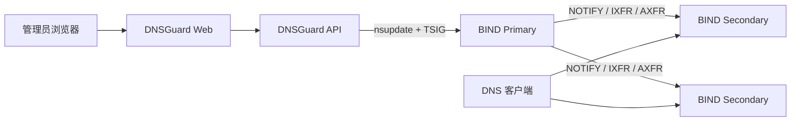

# DNSGuard · 域盾

**让每一次解析，都有安全边界。**

<p align="center"></p>

DNSGuard 是 BIND RPZ 的轻量级 Web 控制面。它管理白名单、A 重定向、发布任务和审计记录，再通过 `nsupdate + TSIG` 更新 BIND Primary。BIND 继续负责递归解析以及 Primary/Secondary 同步。

DNSGuard 不替代 BIND、不参与客户端 DNS 查询，也不会自动修改或重启生产 BIND。

## 核心能力

| 能力 | 说明 |
|---|---|
| 白名单与重定向 | PASSTHRU 白名单、多级子域名放行、A 记录重定向 |
| 全局默认 DENY | 独立 `global-deny.rpz.local`；白名单和重定向优先 |
| 安全发布 | 草稿审核、`nsupdate + TSIG`、SOA/Secondary 同步核验 |
| 可靠性保护 | `pending_verification`、`reconcile_required`、人工核对和版本回滚 |
| 安全运维 | 登录、CSRF、审计哈希链、JSON 持久化、备份恢复 |

## 架构



生产 Compose 只运行 `dnsguard-api` 和 `dnsguard-web`；BIND 集群由管理员独立部署。

## 环境要求

- Docker Engine 24+ 和 Docker Compose Plugin 2.20+。
- 首次启动前只需要 Docker 权限、可信 HTTPS 证书和私钥；BIND、RPZ Zone、TSIG 可以在平台启动后通过 Web 向导接入。
- 完成 BIND 接入时，DNSGuard API 必须能访问 Primary/Secondary 的 DNS、SOA 和必要的 AXFR 路径。
- 不需要在 DNSGuard 主机安装 Go、Node.js、npm 或 BIND。

安装前请确认当前安装用户可以执行 `docker info`，而不只是读取
`docker compose version`；Docker Socket 权限应由管理员预先配置，安装器不会修改用户组或放宽 Socket 权限。
HTTPS 证书和私钥必须由管理员提供；安装器不会生成不可信的临时证书。已有 BIND 的 TSIG、业务 RPZ
和独立的 `global-deny.rpz.local` Zone 可在 Web 接入阶段准备。DNSGuard 只负责控制面和
`nsupdate + TSIG` 发布，不代替管理员配置生产 BIND、`response-policy` 或 Primary/Secondary 同步。

## 快速开始

### 1. 获取 v1.1.1 并先启动控制面

先克隆仓库，再运行仓库内安装入口：

```bash
git clone --branch v1.1.1 --single-branch \
  https://github.com/Bl4ckB1t7/dnsguard.git dnsguard
cd dnsguard
./install.sh
```

首次尚未存在 `deploy/docker/dnsguard.env` 时，安装脚本会检查 Docker/Compose，准备目录，生成运行密钥和一次性 Bootstrap Token，并只要求提供可信 HTTPS 证书和私钥。此时不要求 BIND、RPZ Zone 或 TSIG；平台启动后再通过 Web 向导接入。缺少证书、私钥或 Docker 权限时会明确失败，不会留下可冒充成功的半成品环境文件。

如果 BIND 在另一套已经存在的 Docker 网络中，先设置网络名再安装：

```bash
export DNSGUARD_BIND_NETWORK=existing-bind-network
./install.sh
```

安装会检查该外部网络及其实际 Subnet 是否被 `DNS_NODE_ALLOWED_CIDRS` 明确授权，不会创建网络或自动放宽 CIDR。API 使用该网络中 BIND 可达的地址和 `53` 端口；宿主机映射端口不能填入容器配置。普通物理机/虚拟机 BIND 不设置此变量。

Bootstrap Token 不会打印到普通日志。默认安装后在仓库根目录用受保护终端读取：

```bash
sudo cat ./secrets/bootstrap.token
```

如果设置了 `DNSGUARD_SECRET_DIR`，读取该自定义目录下的 `bootstrap.token`；安装脚本最后输出的实际路径优先。不要把 Token 放进聊天、截图或工单。重复执行安装不会覆盖现有配置、密钥、Token 或数据。

### 2. 首次上线顺序

打开安装输出的 HTTPS 地址，按以下顺序操作：

1. 打开 Web，使用 Bootstrap Token 创建管理员；平台此时已启动，但 BIND 尚未接入，RPZ 发布保持禁用。
2. 在向导中填写 BIND Primary、Secondary、RPZ Zone 和 Global Deny Zone。可先预览或下载 RPZ 初始化配置包；配置包不含 TSIG Secret，也不会修改 BIND。
3. 由 BIND 管理员在受保护主机审核并应用配置，备份后执行 `named-checkconf`、`named-checkzone`，再按现有变更流程启用业务 RPZ。已有授权 TSIG 需要安全放入 secrets 目录；新 Key 必须由 BIND 管理员生成并同步配置 Primary。
4. 返回 Web 完成连通性、SOA、TSIG 写权限和 Primary/Secondary 同步检查。BIND 未通过检查前，RPZ 发布保持禁用。
5. 在 RPZ 规则页面导入 TXT（每行一个域名）或白名单 JSON，审核后保存为 `draft`。
6. 人工确认并发布白名单/A 重定向，等待 Primary 和所有 Secondary 验证成功。
7. 由 BIND 管理员预创建 `global-deny.rpz.local`；只有白名单发布并完成同步后，才可将它加入 `response-policy`，再按[BIND RPZ 对接文档](docs/bind-rpz-deployment.md)完成递归基线和只读核验。
8. 确认白名单、多级子域名、A 重定向和未知域名的实际递归结果。DNSGuard 不会修改或 reload BIND。

普通 BIND 使用：

```bash
docker compose --env-file deploy/docker/dnsguard.env \
  -f compose.yaml up -d --force-recreate
```

如果设置了 `DNSGUARD_BIND_NETWORK`，收尾脚本和手工重建都必须保留外部网络 override：

```bash
export DNSGUARD_BIND_NETWORK=existing-bind-network
docker compose --env-file deploy/docker/dnsguard.env \
  -f compose.yaml -f compose.bind-network.yaml up -d --force-recreate
```

收尾脚本不会修改或 reload BIND，也不会重新构建镜像；失败时会保留 env 保护备份并给出恢复提示。

首次平台启动使用 deferred 是为了在 BIND 尚未接入时开放安全的 Web 向导；BIND 接入后仍须先完成白名单发布和同步，再由管理员启用 Global Deny 并执行最终只读核验。未完成 BIND 接入前不会开放 RPZ 发布。

完成真实发布、节点同步和全局 DENY 只读核验后，首次部署引导会完全消失。之后新增 `draft` 或 Secondary 暂时离线不会重新打开引导；这些状态仍在规则和节点页面显示。

## 安全边界

- DNSGuard 仅通过 `nsupdate + TSIG` 更新管理员预先配置的 RPZ Zone，不修改 `named.conf`、`response-policy` 或生产 Zone 文件。
- 客户端收到 `NXDOMAIN` 不等于完整 QNAME 没有到达上游。
- 隔离测试中部分 DNSSEC `DO=1` 查询仍可能到达上游；上线前必须按目标 BIND 配置单独验证。
- 全局 DENY 不应被宣传为所有查询类型和 DNSSEC 场景下百分之百阻断 DNS 隧道。
- 不要把生产 TSIG、Bootstrap Token、HTTPS 私钥或真实业务数据提交到 Git。

## 两套 Zone 的名称

- `global-deny.rpz.local`：v1.1.0+ 的全局默认 DENY Zone，不依赖 IANA TLD 列表。
- `tld-deny.rpz.local`：v1.0.1 的旧 TLD 兼容路径，升级时保留历史数据，但不是 v1.1.1 全局 DENY 的必要依赖。

## 界面预览

| 登录页 | DNS 控制台 |
|---|---|
|  |  |

## 文档

- [Docker 安装与初始化](deploy/docker/README.md)
- [高级运维：备份、恢复、升级和迁移](docs/docker-operations.md)
- [BIND RPZ 部署与对接](docs/bind-rpz-deployment.md)
- [v1.1.0 隔离验收](docs/acceptance/v1.1.0-first-deployment-acceptance.md)
- [DNS 隧道重新验收](docs/acceptance/v1.1.0-dns-tunnel-retest.md)
- [v1.0.1 正式验收](docs/acceptance/v1.0.1-bind-acceptance.md)
- [安全说明](SECURITY.md) · [发布说明](RELEASE_NOTES.md) · [许可证](LICENSE)

## License

MIT License
