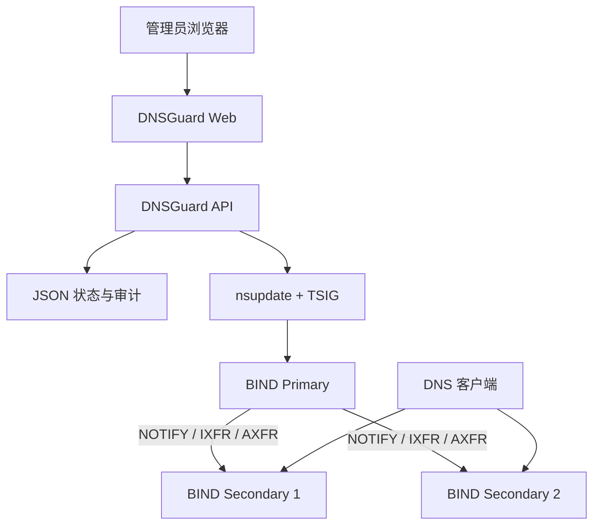

# DNSGuard · 域盾

**轻量级 BIND RPZ 安全策略管理平台**

> **让每一次解析，都有安全边界。**

<p align="center">
  
</p>

DNSGuard 是一个面向企业和网络管理员的 DNS 安全策略控制面，通过 Web 界面管理 RPZ 规则、DNS 节点、发布任务和审计记录。

DNSGuard 不替代 BIND，不参与客户端 DNS 查询，也不要求改造现有 DNS 架构。它通过 `nsupdate + TSIG` 向 BIND Primary 发布策略，由 BIND 原生机制将变更同步到 Secondary。

> **核心原则：控制面与 DNS 数据面分离。即使 DNSGuard 停止运行，BIND 仍可独立提供已加载的 DNS 解析服务。**

## 核心功能

| 功能 | 说明 |
|---|---|
| RPZ 规则管理 | 支持 passthru 白名单、A 记录重定向 |
| 受控策略发布 | 发布预览、规则校验、TSIG 动态更新 |
| BIND 集群管理 | Primary / Secondary 状态、SOA Serial、同步检查 |
| 发布任务追踪 | 发布状态、异常诊断、中断恢复与人工核对 |
| 版本管理 | 策略版本记录和受控回滚 |
| 操作审计 | 操作记录、审计哈希链和异常保护 |
| TLD 数据状态 | 每日校验 IANA TLD 列表，在控制台显示当前数量和版本 |
| 安全认证 | 管理员登录、会话保护、CSRF 和访问限制 |
| Docker 部署 | Docker Compose、一体化 Web 初始化向导 |
| 数据持久化 | 使用 JSON 文件，无需独立数据库 |

## 工作原理



**DNSGuard 管理策略，BIND 执行策略。**

生产部署只包含 `dnsguard-api` 和 `dnsguard-web` 两个 Docker 服务。BIND DNS 服务器保持独立运行。

## BIND RPZ 如何接入

先准备 BIND RPZ Primary、Secondary、TSIG、Zone Transfer 和递归 DNS 的 `response-policy`，再运行 DNSGuard 初始化向导。DNSGuard 通过 `nsupdate + TSIG` 更新 Primary，由 BIND 原生的 NOTIFY / IXFR / AXFR 同步到 Secondary。

完整的 BIND 配置模板、端口要求、规则匹配说明和发布前检查见：[BIND RPZ 部署与 DNSGuard 对接](docs/bind-rpz-deployment.md)。文档中的地址、密钥和域名均为占位符，不要直接用于生产。

仓库还提供一键只读对接检查。先复制并填写 `deploy/docker/rpz-connect.env.example` 中的地址和宿主机 TSIG 路径，再执行：

```bash
./scripts/rpz-connect.sh --env-file /path/to/rpz-connect.env
```

它只检查节点、SOA、Serial 和 TSIG 文件权限，不会自动修改或重启 BIND。

## 快速开始

DNSGuard V1.0 采用 **Docker Compose Only** 部署。

环境要求：Docker Engine、Docker Compose Plugin、现有 BIND RPZ 集群、TSIG Key 和 HTTPS 证书。

```bash
git clone --branch v1.0.0 --single-branch https://github.com/Bl4ckB1t7/dnsguard.git dnsguard
cd dnsguard

cp deploy/docker/dnsguard.env.example deploy/docker/dnsguard.env

# 按部署手册准备配置、TSIG Key 和 HTTPS 证书
./scripts/docker-init.sh
docker compose up -d
docker compose ps
```

首次打开 HTTPS 管理页面后，使用 Web 初始化向导完成管理员创建、DNS 节点配置和 TSIG 验证。

**完整安装说明：** [Docker 部署与运维手册](deploy/docker/README.md)

## 界面预览

登录页和控制台分别如下，便于快速了解 DNSGuard 的使用方式：

| 安全登录 | DNS 控制台 |
|---|---|
|  |  |

## 安全与部署边界

DNSGuard 仅管理经过授权的 BIND RPZ 集群，不会自动安装、修改或重启生产 BIND。生产环境必须使用 HTTPS，并妥善保护 TSIG 密钥和持久化数据。

控制台的 **TLD 数据状态**卡片显示 IANA TLD 数据的数量、版本和同步状态。默认每 24 小时检查一次；下载失败时保留上一份有效状态。默认不发布 deny RPZ；管理员在隔离环境配置并验证第二个 RPZ Zone 后，可显式启用 `TLD_DENY_PUBLISH_ENABLED=true`，由 DNSGuard 通过现有 `nsupdate + TSIG` 更新该 Zone。DNSGuard 不会自动修改 `named.conf`、重启 BIND 或改变递归配置。

正式部署前，应在隔离环境完成 RPZ 发布、同步、备份和恢复测试。

## 文档

- [Docker 安装、初始化与运维](deploy/docker/README.md)
- [版本发布说明](RELEASE_NOTES.md)
- [安全说明](SECURITY.md)
- [许可证](LICENSE)

## 本地开发与隔离测试

本地开发仍可使用 Go 和 React，但这不是生产部署方式：

```bash
npm ci
npm run build
(cd server && go test ./... -count=1)
```

隔离验收测试使用独立 Docker 网络、测试 TSIG 和临时目录，不连接生产 DNS：

```bash
./tests/backup-restore.sh
./tests/docker-initialization-wizard.sh
./tests/docker-production-deployment.sh
./tests/bind-cluster/run-acceptance.sh
```

## License

MIT License
