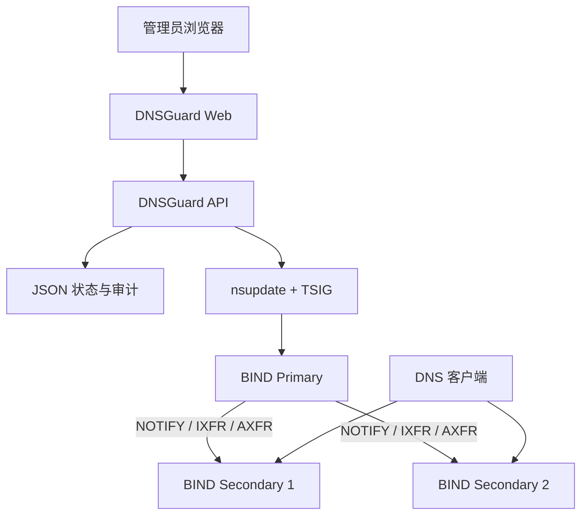

# DNSGuard · 域盾

**轻量级 BIND RPZ 安全策略管理平台**

> **让每一次解析，都有安全边界。**

<p align="center">
  
</p>

DNSGuard 是一个面向企业和网络管理员的 DNS 安全策略控制面，通过 Web 界面管理 RPZ 规则、DNS 节点、发布任务和审计记录。

DNSGuard 不替代 BIND，不参与客户端 DNS 查询，也不要求改造现有 DNS 架构。它通过 `nsupdate + TSIG` 向 BIND Primary 发布策略，由 BIND 原生机制将变更同步到 Secondary。

> **核心原则：控制面与 DNS 数据面分离。即使 DNSGuard 停止运行，BIND 仍可独立提供已加载的 DNS 解析服务。**

## 核心功能

| 功能 | 说明 |
|---|---|
| RPZ 规则管理 | 支持 passthru 白名单、A 记录重定向和多级子域名匹配 |
| 全局默认 DENY | 独立 `global-deny` RPZ Zone；白名单和 A 重定向优先，其余默认拒绝 |
| 初始白名单导入 | 对接脚本生成经过校验的 JSON，初始化时作为未发布草稿导入 |
| 受控策略发布 | 增量、分批 `nsupdate + TSIG` 发布和发布预览 |
| BIND 集群管理 | Primary / Secondary 状态、SOA Serial 和同步检查 |
| 完整性核对 | Primary / Secondary SOA、只读 AXFR 和实际递归效果校验 |
| 发布任务追踪 | `pending_verification`、`reconcile_required`、异常诊断和人工核对 |
| 版本与审计 | 策略版本、受控回滚、审计哈希链和恢复保护 |
| 安全认证 | 管理员登录、会话保护、CSRF 和访问限制 |
| Docker 部署 | Docker Compose、一体化 Web 初始化向导 |
| 数据持久化 | 使用 JSON 文件，无需独立数据库 |

## 工作原理



**DNSGuard 管理策略，BIND 执行策略。**

生产部署只包含 `dnsguard-api` 和 `dnsguard-web` 两个 Docker 服务。BIND DNS 服务器保持独立运行。

## 部署前：对接现有 BIND RPZ 集群

### 部署边界

DNSGuard 是 DNS 策略控制面，生产 Docker Compose 只部署 `dnsguard-api` 和 `dnsguard-web`。BIND Primary / Secondary 由管理员独立部署，DNSGuard 不负责安装 BIND、修改 `named.conf`、修改 `response-policy`、直接编辑 Zone 文件或 reload/restart BIND。

### BIND 管理员需要提前准备

在部署 DNSGuard 前，请确认：

1. BIND Primary 和至少一台 Secondary 已正常工作。
2. 白名单 / A 重定向 RPZ Zone 已创建并可用。
3. 递归 DNS 的 `response-policy` 已按管理员规划配置正确的 Zone 顺序，白名单 / 重定向 Zone 位于全局 deny Zone 之前。
4. 已准备最小权限 TSIG Key 和动态更新权限。
5. Primary 到 Secondary 的 NOTIFY / IXFR / AXFR 已配置并可用。
6. 如启用 v1.1.0 全局默认 DENY，已提前创建独立 `global-deny` RPZ Zone，并在递归实例配置白名单 / 重定向 Zone 优先。
7. 已为 DNSGuard 配置必要的只读 SOA / AXFR 检查权限；DNSGuard 不会自动创建或写入全局 DENY Zone。
8. DNS TCP/UDP 53、必要的 Zone Transfer、DNSGuard HTTPS 等网络路径可达。
9. 如启用 IANA 同步，DNSGuard 可以访问 IANA HTTPS 数据源。
10. 管理员已独立评估递归设置和 DNS 查询外传风险。

具体 BIND 配置、TSIG、Zone Transfer 和 `response-policy` 说明见：[BIND RPZ 部署与 DNSGuard 对接](docs/bind-rpz-deployment.md)。其中的地址、密钥和域名均为占位符，不要直接用于生产。

### 部署前只读对接检查

脚本参数以 [`scripts/rpz-connect.sh`](scripts/rpz-connect.sh) 实际实现为准。先准备配置文件：

```bash
cp deploy/docker/rpz-connect.env.example /path/to/rpz-connect.env
# 按实际 BIND 地址、RPZ Zone、Secondary 和宿主机 TSIG 文件路径修改

./scripts/rpz-connect.sh --env-file /path/to/rpz-connect.env
```

默认是只读预检，检查工具、TSIG 文件权限、Primary / Secondary SOA Serial、节点连通性和同步一致性；配置可选参数时，还会执行实际递归 A、白名单或全局 deny 证据检查。参数不完整的可选检查会显示 `NOT RUN`。该命令不修改 RPZ 记录、不修改 BIND 配置、不 reload/restart BIND，也不会自动修复失败项。

检查失败时，应先排查 BIND 配置、TSIG 权限和网络连通性，不要绕过安全检查。

如需在启用严格策略前准备初始白名单，可在对接检查时额外导出 JSON。输入文件每行一个域名，脚本只做规范化、去重和格式校验，不执行 DNS UPDATE：

```bash
./scripts/rpz-connect.sh \
  --env-file /path/to/rpz-connect.env \
  --whitelist-file /path/to/approved-domains.txt \
  --export-whitelist-json /path/to/whitelist-seed.json

install -d -m 0750 docker-data/bootstrap
install -m 0600 /path/to/whitelist-seed.json docker-data/bootstrap/whitelist-seed.json
printf '\nRPZ_WHITELIST_SEED_FILE=/var/lib/dnsguard/bootstrap/whitelist-seed.json\n' >> deploy/docker/dnsguard.env
```

启动后初始化向导会显示发现的条目数量，并将其导入为未发布草稿；不会自动修改 BIND。管理员应在页面核对后，再使用正常发布流程提交白名单。已有 DNSGuard 数据时不会重新导入或覆盖现有规则。

新部署的 v1.1.0 模式使用 `RPZ_DEFAULT_DENY_MODE=global`，还必须配置预先存在的 `RPZ_GLOBAL_DENY_ZONE`、递归测试地址和测试域名。初始化只读核对 deny Zone 的 Primary/Secondary SOA、根级通配触发项和递归测试；任何必要检查未通过都不会打开初始化完成条件。

### 可选：受控临时 TXT 写入测试

脚本支持显式授权的临时 TXT 测试，但默认不开启。只有在隔离环境或已批准的维护窗口中，才执行：

```bash
./scripts/rpz-connect.sh \
  --env-file /path/to/rpz-connect.env \
  --write-test --confirm WRITE-TEST
```

该模式只使用脚本生成的随机测试名称和随机 TXT 内容，默认限制在 `_dnsguard-preflight.<RPZ_ZONE>` 命名空间；自定义名称也必须位于受保护测试命名空间内。脚本会先确认目标不存在，写入后精确删除并再次查询确认。写入、读回或清理结果不确定时会失败并要求人工核对，不会执行正式 RPZ 发布。不要把实际业务域名或业务策略作为测试对象。

### 双 RPZ Zone 架构（v1.1.0）

- **Zone 1：白名单与 A 重定向**：管理 `passthru` 白名单、域名及多级子域名放行，以及 A 记录重定向。
- **Zone 2：全局 DENY**：由 BIND 管理员预先准备，例如 `global-deny.rpz.local` 中的 `* IN CNAME .`；DNSGuard 只读核对，不自动修改该 Zone。

白名单 / 重定向 Zone 必须在 BIND 的 RPZ 策略顺序中具有更高优先级。DNSGuard 只通过 `nsupdate + TSIG` 更新白名单 / 重定向 Primary Zone；全局 DENY Zone 由 BIND 管理员独立维护，Primary / Secondary 同步由 BIND 原生 NOTIFY / IXFR / AXFR 完成。

v1.1.0 的全局 DENY 是显式配置的正式策略，但不应宣传为在所有 BIND 配置、查询类型和 DNSSEC 场景下百分之百阻止 DNS C2 或数据外传。`NXDOMAIN` 只能说明客户端收到的结果；上游是否看到 QNAME 必须在目标递归配置下单独验证。`qname-wait-recurse` 等选项由 BIND 管理员独立维护，DNSGuard 不会自动设置。

## 快速开始

DNSGuard v1.1.0 继续采用 **Docker Compose Only** 部署；v1.1.0 尚未创建正式 Tag 或 Release。

环境要求：Docker Engine、Docker Compose Plugin、现有 BIND RPZ 集群、TSIG Key 和 HTTPS 证书。

```bash
git clone --branch main --single-branch https://github.com/Bl4ckB1t7/dnsguard.git dnsguard
cd dnsguard

cp deploy/docker/dnsguard.env.example deploy/docker/dnsguard.env

# 按部署手册准备配置、TSIG Key 和 HTTPS 证书
./scripts/docker-init.sh
docker compose up -d
docker compose ps
```

首次打开 HTTPS 管理页面后，使用 Web 初始化向导完成管理员创建、DNS 节点配置和 TSIG 验证。

**完整安装说明：** [Docker 部署与运维手册](deploy/docker/README.md)

**当前稳定版本：** [DNSGuard v1.0.1 GitHub Release](https://github.com/Bl4ckB1t7/dnsguard/releases/tag/v1.0.1)。v1.1.0 全局 DENY 功能在本分支开发和验收，正式发布前不要用于生产。

推荐的部署顺序是：先准备并验证独立 BIND 集群，整理白名单并导出初始 JSON，预置全局 deny Zone 和 RPZ 顺序，执行只读对接预检，再启动 DNSGuard Compose，完成 Web 初始化，核对并发布白名单，最后验证递归行为和同步状态。DNSGuard 不会替管理员修改 BIND 配置。

## 界面预览

登录页和控制台分别如下，便于快速了解 DNSGuard 的使用方式：

| 安全登录 | DNS 控制台 |
|---|---|
|  |  |

## 安全与部署边界

DNSGuard 仅管理经过授权的 BIND RPZ 集群，不会自动安装、修改或重启生产 BIND。生产环境必须使用 HTTPS，并妥善保护 TSIG 密钥和持久化数据。

控制台显示当前策略模式和全局 DENY Zone。v1.1.0 不再依赖 IANA TLD 列表实现默认拒绝；旧版 TLD 状态、发布记录和接口仍保留用于升级兼容，但默认关闭，不作为全局 DENY 可用性的判断依据。

正式部署前，应在隔离环境完成 RPZ 发布、同步、备份和恢复测试。

## v1.0.1 隔离 BIND 验收摘要

正式验收使用 BIND 9.20.30 和真实隔离 Primary / Secondary 集群完成：

- 测试 TLD：1,436 个；RPZ 拒绝触发项：2,872 条；`nsupdate`：15 批。
- Primary / Secondary SOA：`16 / 16 / 16`；AXFR 全量核对：PASS。
- 白名单、多级子域名、A 重定向和 TLD 默认拒绝：PASS。
- 隔离上游查询观测未发现被拒绝查询名称到达受控上游。
- 总结果：`20 PASS / 0 FAIL / 0 NOT RUN`。

这些结果来自隔离 BIND 配置，不代表所有生产 BIND 配置均已验证；客户端收到 `NXDOMAIN` 也不能单独等同于完全阻止 DNS 数据外传。详见：[v1.0.1 隔离 BIND 正式验收报告](docs/acceptance/v1.0.1-bind-acceptance.md)。

## v1.1.0 全局 DENY 验收边界

v1.1.0 的功能验收使用独立 BIND Primary、两台 Secondary 和受控上游，覆盖全局 deny Zone、白名单 / 多级子域名、A 重定向、SOA 同步和递归结果。DO=1、AAAA、TXT 及上游是否观察到被拒绝 QNAME，均按隔离配置单独记录；详见[全局 DENY 隔离验收报告](docs/acceptance/v1.1.0-global-deny-acceptance.md)。

## 文档

- [DNSGuard v1.0.1 GitHub Release](https://github.com/Bl4ckB1t7/dnsguard/releases/tag/v1.0.1)
- [BIND RPZ 部署与 DNSGuard 对接](docs/bind-rpz-deployment.md)
- [Docker 安装、初始化与运维](deploy/docker/README.md)
- [v1.0.1 隔离 BIND 验收报告](docs/acceptance/v1.0.1-bind-acceptance.md)
- [版本发布说明](RELEASE_NOTES.md)
- [安全说明](SECURITY.md)
- [许可证](LICENSE)

## 本地开发与隔离测试

本地开发仍可使用 Go 和 React，但这不是生产部署方式：

```bash
npm ci
npm run build
(cd server && go test ./... -count=1)
```

隔离验收测试使用独立 Docker 网络、测试 TSIG 和临时目录，不连接生产 DNS：

```bash
./tests/backup-restore.sh
./tests/docker-initialization-wizard.sh
./tests/docker-production-deployment.sh
./tests/bind-cluster/run-acceptance.sh
```

## License

MIT License
