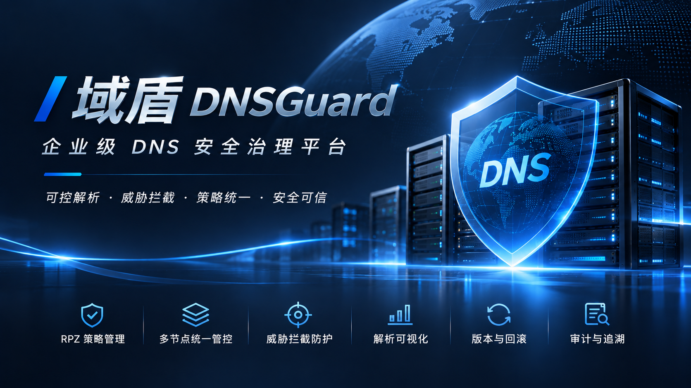
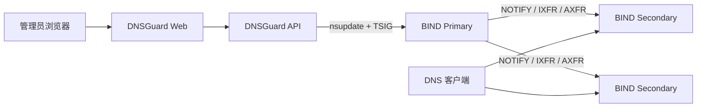
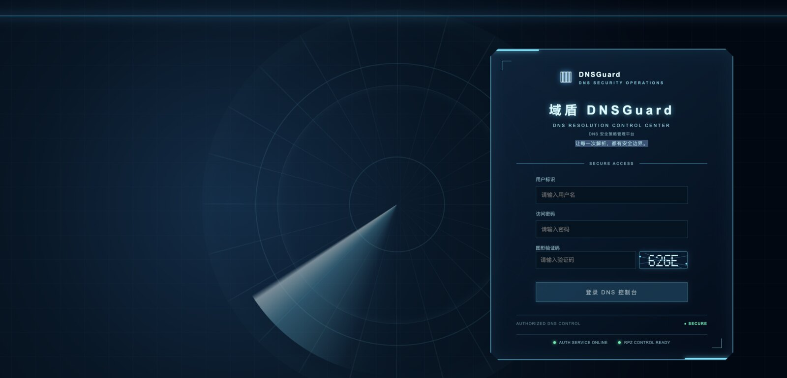
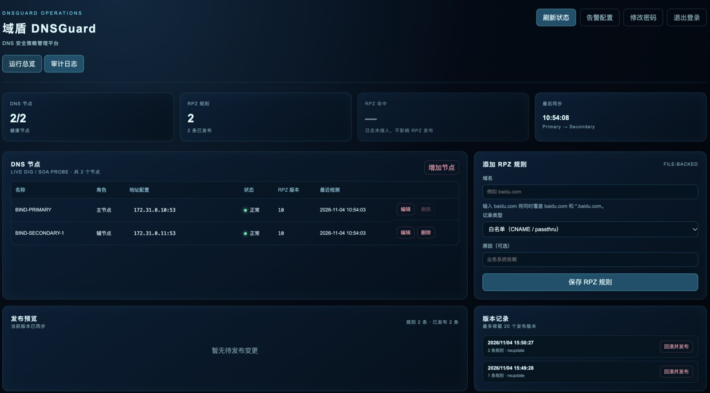

# DNSGuard · 域盾

**让每一次解析，都有安全边界。**

<p align="center"></p>

DNSGuard 是 BIND RPZ 的轻量级 Web 控制面：管理员在页面管理白名单、A 重定向、发布任务和审计记录，DNSGuard 再通过 `nsupdate + TSIG` 更新 BIND Primary。BIND 继续负责递归解析和 Primary/Secondary 同步。

DNSGuard 不替代 BIND、不参与客户端 DNS 查询，也不会自动修改或重启生产 BIND。

## 核心能力

| 能力 | 说明 |
|---|---|
| 白名单与重定向 | PASSTHRU 白名单、多级子域名放行、A 记录重定向 |
| 全局默认 DENY | 独立 `global-deny` RPZ Zone；白名单和重定向优先 |
| 安全发布 | 预览、`nsupdate + TSIG`、SOA/Secondary 同步核验 |
| 可靠性保护 | `pending_verification`、`reconcile_required`、人工核对和版本回滚 |
| 初始导入 | 审核后的域名列表导入为 `draft`，不会自动发布 |
| 安全运维 | 登录、CSRF、审计哈希链、JSON 持久化、备份恢复 |

## 架构



生产 Compose 只运行 `dnsguard-api` 和 `dnsguard-web`；BIND 集群由管理员独立部署。

## 部署前准备

请先确认：

1. BIND Primary 和至少一台 Secondary 正常运行。
2. 白名单/A 重定向 RPZ Zone、动态更新 TSIG 和 Zone Transfer 已配置。
3. 如启用 v1.1.0 全局 DENY，已预先创建独立 deny Zone，但首次上线暂不加入 `response-policy`。
4. 白名单 Zone 在 `response-policy` 中优先于 deny Zone。
5. DNSGuard 主机可访问 BIND 的 DNS、SOA 和必要的 AXFR 路径。

先执行只读对接检查：

```bash
cp deploy/docker/rpz-connect.env.example /path/to/rpz-connect.env
./scripts/rpz-connect.sh --env-file /path/to/rpz-connect.env
```

需要准备初始白名单时，输入文件每行一个域名：

```bash
./scripts/rpz-connect.sh --env-file /path/to/rpz-connect.env \
  --whitelist-file approved-domains.txt \
  --export-whitelist-json whitelist-seed.json
install -d -m 0750 docker-data/bootstrap
install -m 0600 whitelist-seed.json docker-data/bootstrap/whitelist-seed.json
```

脚本默认只读，不修改 BIND。完整配置见 [BIND RPZ 对接文档](docs/bind-rpz-deployment.md)。

## 快速开始

正式部署请使用已批准的 `v1.1.0` 版本：

```bash
git clone --branch v1.1.0 --single-branch \
  https://github.com/Bl4ckB1t7/dnsguard.git dnsguard
cd dnsguard
```

准备现有 BIND 的 TSIG Key 和企业 HTTPS 证书后，使用一键入口：

```bash
./install.sh
```

脚本只生成随机运行密钥和一次性 Bootstrap Token，不显示 Token，也不会覆盖已有数据、证书或配置。它不会生成自签名证书；缺少 TSIG 或证书时会安全停止。重复执行只补齐缺失文件，已有文件不会覆盖。

首次初始化的安全顺序必须是：

**审核白名单 → 导入为 `draft` → 发布白名单 → 确认 Primary/Secondary 同步 → 启用全局 DENY → 验证业务。**

登录后，顶部首次上线引导会按这三个阶段显示真实状态。可以在“RPZ 规则”页面直接导入 TXT（每行一个域名）或现有白名单 JSON；导入只创建 `draft`，必须人工审核、发布并确认 Primary/Secondary 同步后，才会进入下一步。

如果首次初始化时 deny Zone 尚未加入 BIND 的 `response-policy`，临时使用：

```dotenv
RPZ_GLOBAL_DENY_SETUP_DEFERRED=true
```

白名单发布并确认同步后，由 BIND 管理员加入 deny Zone，重新验证并移除该临时变量。DNSGuard 不会代为修改 BIND。

安装时必须提供一个在启用 DENY 前确实能正常解析的测试域名；安装和初始化会保存该基线，启用后只有在同一名称返回预期拒绝时才可判定递归检查通过。

## 安全边界

- `NXDOMAIN` 只代表客户端收到拒绝结果，不等于完整 QNAME 没有到达上游。
- 隔离测试中部分 DO=1 查询仍可能到达上游；上线前必须按目标 BIND 配置单独验证。
- 不要把全局 DENY 宣传为所有查询类型和 DNSSEC 场景下的绝对外传阻断。
- 不要把生产 TSIG、Token、证书私钥或真实业务数据提交到 Git。

## 界面预览

| 登录页 | DNS 控制台 |
|---|---|
|  |  |

## 文档

- [Docker 安装与初始化](deploy/docker/README.md)
- [高级运维：备份、恢复、升级和迁移](docs/docker-operations.md)
- [BIND RPZ 部署与对接](docs/bind-rpz-deployment.md)
- [v1.1.0 全局 DENY 验收](docs/acceptance/v1.1.0-global-deny-acceptance.md)
- [DNS 隧道重新验收](docs/acceptance/v1.1.0-dns-tunnel-retest.md)
- [v1.0.1 正式验收](docs/acceptance/v1.0.1-bind-acceptance.md)
- [安全说明](SECURITY.md) · [发布说明](RELEASE_NOTES.md) · [许可证](LICENSE)

## License

MIT License
