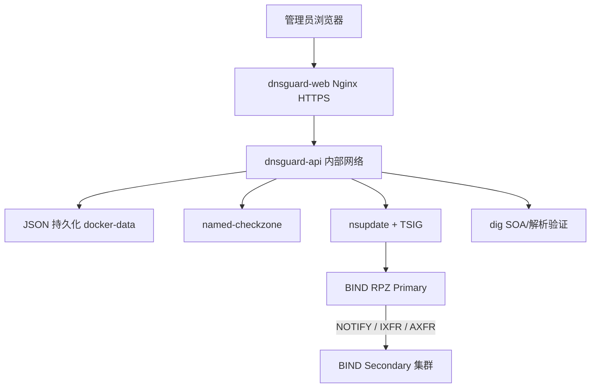

# 域盾（DNSGuard）

DNSGuard 是企业 DNS 的 RPZ 控制面，负责规则管理、受控发布、节点状态、审计、版本和告警配置。BIND Primary/Secondary 始终是 DNS 数据面：DNSGuard 不参与客户端 DNS 查询，控制面停止时，BIND 继续提供已经加载的解析服务。

## V1.0 支持边界

- **生产部署唯一支持 Docker Compose**：安装、启动、停止、升级、备份、恢复和回滚都使用 Compose。
- Compose 只运行 `dnsguard-api` 和 `dnsguard-web`，不会安装、修改或重启生产 BIND。
- 不使用数据库、Redis、Kafka、Kubernetes 或其他额外基础设施。
- JSON 文件是控制面持久化格式，必须持久化 `docker-data/`。
- `tests/` 和 `dev/bind-rpz/` 仅用于开发和隔离验收，不是生产部署入口。

完整交付手册：[`deploy/docker/README.md`](deploy/docker/README.md)。
正式版本说明：[`RELEASE_NOTES.md`](RELEASE_NOTES.md)。

## 解决的问题

企业手工维护 RPZ 容易出现 Zone 格式错误、漏同步、Serial 不一致、误删和无法追踪。DNSGuard 将规则变更、发布预览、`named-checkzone`、`nsupdate + TSIG`、NOTIFY/IXFR/AXFR 状态检查和审计集中到控制面，同时保持 BIND 数据面独立。

## 主要功能

- RPZ passthru 白名单和 A 记录重定向；域名规则同时生成精确及泛域名触发器。
- 发布前规则与 Zone 校验，发布后检查 Primary/Secondary SOA Serial 和实际解析效果。
- 发布任务互斥、不可变规则快照、有限重试、故障诊断和 `reconcile_required` 人工核对状态。
- JSON 原子写入、备份、版本记录和审计哈希链。
- DNS 节点增删改、SOA 健康状态和同步异常识别。
- Web 首次初始化向导：Bootstrap Token、管理员、Primary/Secondary、TSIG 和发布门禁。
- CSRF、Session、Cookie 安全属性、登录限速、验证码、密码修改和管理操作审计。
- Docker Compose 非 root、只读根文件系统、内部 API 网络、HTTPS 和资源限制。

## 生产架构



生产 BIND 不放入 DNSGuard Compose。DNSGuard 只需要从控制面网络访问 Primary 的动态更新端口和所有 Secondary 的 DNS 查询端口。

## Docker Compose 快速安装

目标服务器不需要安装 Go、Node.js、npm 或手动创建服务文件。准备 Docker Engine、Compose Plugin、生产 TSIG 和 HTTPS 证书后执行：

```bash
git clone https://github.com/Bl4ckB1t7/dnsguard.git
cd dnsguard
git checkout v1.0.0
cp deploy/docker/dnsguard.env.example deploy/docker/dnsguard.env
install -d -m 0750 docker-data secrets tls bind-logs
install -m 0640 PATH_TO_PRODUCTION_RPZ_KEY secrets/rpz-manager.key
install -m 0644 PATH_TO_FULLCHAIN_PEM tls/fullchain.pem
install -o 101 -g 101 -m 0640 PATH_TO_PRIVATE_KEY tls/privkey.pem
umask 077
openssl rand -hex 32 > secrets/bootstrap.token
chown 10001:10001 secrets/bootstrap.token
chmod 0600 secrets/bootstrap.token
./scripts/docker-init.sh
docker compose up -d
docker compose ps
```

编辑 `deploy/docker/dnsguard.env` 中的 `AUTH_SECRET`、`MONITORING_TOKEN`、`RPZ_PRIMARY`、`RPZ_ZONE`、允许网段和节点地址。不要把该文件、TSIG、Bootstrap Token、证书私钥或 `docker-data/` 提交到 Git。

默认只有 Web 暴露 HTTPS 端口，API 没有宿主机端口。生产入口必须使用 HTTPS，并限制管理网段访问。详细首次初始化、检查、故障处理和升级流程见 Docker 手册。

## 一次性迁移旧部署数据

Docker Only 不会自动读取或删除旧主机上的数据。迁移前先停止旧控制面并保留原目录副本；不要覆盖原目录，也不要将旧服务和新 Compose 同时绑定同一端口。

1. 备份旧配置、认证文件、节点文件、状态、审计、版本、发布任务、Telegram 配置、RPZ 产物、TSIG 和证书。
2. 在新仓库准备 `docker-data/`、`secrets/`、`tls/` 和 `bind-logs/`。
3. 将旧状态文件复制到 `docker-data/`，将 TSIG 复制到 `secrets/rpz-manager.key`，将证书复制到 `tls/`。
4. 按容器 UID 修正权限：`docker-data/` 与 TSIG 归 UID/GID `10001:10001`，TLS 私钥可读于 `101:101`，认证文件 `0600`，Bootstrap Token `0600`。
5. 检查 `AUTH_FILE`、`DNS_NODE_CONFIG_FILE`、`DNS_STATE_FILE`、`AUDIT_FILE` 等容器内路径，不要把 `/var/lib/dnsguard` 当成宿主机路径写入备份命令。
6. 执行 `./scripts/docker-init.sh` 和 `docker compose config`，确认已有认证和节点文件未被覆盖，再启动 Compose。
7. 登录后核对节点、RPZ 规则、版本、任务和审计哈希链，并分别 `dig` 查询 Primary/Secondary 的 Serial 和关键规则。
8. 确认新环境稳定后，再由人工下线旧控制面。迁移不自动修改 BIND Zone；状态文件恢复也不等于 RPZ 已回滚。

## 开发与隔离测试

本地开发仍可直接使用 Go 和 React，但这不是生产部署方式：

```bash
npm ci
npm run build
(cd server && go test ./... -count=1)
```

隔离 BIND/RPZ 联调环境：

```bash
./scripts/start-bind-rpz.sh
./scripts/test-functional.sh
./scripts/stop-bind-rpz.sh
```

自动化验收：

```bash
(cd server && go test ./... -count=1 && go test -race ./... -count=1 && go vet ./...)
npm run build
./tests/backup-restore.sh
./tests/docker-initialization-wizard.sh
./tests/docker-production-deployment.sh
./tests/bind-cluster/run-acceptance.sh
```

所有 BIND 测试均使用隔离容器和测试 TSIG，禁止指向生产 DNS。Docker 测试生成的状态、密钥、日志和报告位于被忽略的 runtime 目录。

## 日常运维

```bash
docker compose ps
docker compose logs --tail=200 dnsguard-api
docker compose logs --tail=200 dnsguard-web
docker compose stop
docker compose start
docker compose down
```

发布异常时不要删除 `docker-data/`，不要直接修改 BIND Zone 文件。出现 `reconcile_required` 时，先人工核对 Primary/所有 Secondary 的 SOA Serial 和实际解析结果，再决定重试或回滚。

## 备份和恢复

备份脚本只支持 Docker Compose：

```bash
docker compose stop
DNSGUARD_BACKUP_MODE=docker \
DNSGUARD_DATA_DIR="$PWD/docker-data" \
DNSGUARD_SECRET_DIR="$PWD/secrets" \
DNSGUARD_TLS_DIR="$PWD/tls" \
BACKUP_DIR=/secure/backup/dnsguard \
./scripts/backup-dnsguard.sh
```

恢复前必须 `docker compose down`。普通状态恢复不会自动恢复 TSIG/私钥；敏感文件必须显式使用 `RESTORE_INCLUDE_SENSITIVE=true`。归档包含 SHA-256 manifest，恢复脚本会检查路径、校验和、权限、UID/GID，并拒绝运行中的 Compose 恢复。恢复后重新启动并人工核对 BIND，不能把旧 JSON 当成 Zone 回滚。

## 目录结构

```text
compose.yaml                 Docker Compose 唯一生产入口
Dockerfile                   Go/React 多阶段镜像构建
deploy/docker/               Docker 配置、环境模板和交付手册
scripts/docker-init.sh       Docker 初始化与安全预检查
scripts/backup-dnsguard.sh   Docker 宿主机路径备份
scripts/restore-dnsguard.sh  Docker 宿主机路径恢复
server/                      Go API 与单元测试
src/                         React 前端
dev/bind-rpz/                本地 BIND 联调
tests/                       隔离验收测试
```

## 安全边界

DNSGuard 只管理 RPZ 控制面。生产变更必须确认 DNS 节点、RPZ Zone、TSIG 和管理网络均已授权。不要在生产环境执行故障注入，不要将生产密钥、密码、Token、证书或日志提交到仓库。
