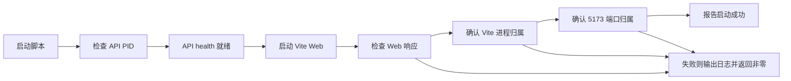

# 六项审计问题优化与测试反馈

## 结论

本轮针对上一轮代码审计确认的 6 项问题逐项完成修复，并在每项修改后执行后端单元测试、竞态测试、静态检查、前端构建和功能回归。当前工作区已推送到 GitHub，最终运行状态正常，认证保持开启。

最终结果：

- npm 生产依赖审计：`0 vulnerabilities`
- Go 单元测试：通过
- Go race 测试：通过
- `go vet`：通过
- 前端构建：通过
- 功能测试：11/11 通过
- 认证运行态：`/api/auth/me` 返回 401，符合开启认证预期
- DNS 节点运行态：3/3 healthy

## 变更总览

| 编号 | 问题 | 修复结果 | 提交 |
|---|---|---|---|
| F-001 | Vite/source-map-js 生产依赖存在高危审计项 | 升级 Vite 并重新生成 lockfile，npm audit 清零 | `f2cbc71` |
| F-002 | Web 端口被占用时启动脚本仍可能报告成功 | 增加 API/Web 就绪检查、进程归属检查和端口归属检查 | `8e95977` |
| F-003 | RPZ 操作告警受事件冷却影响，连续操作可能丢告警 | `rpz_rule_*` 操作不再按事件冷却抑制 | `1b3c8c3` |
| F-004 | Telegram 发送失败也会消耗冷却时间 | 仅在 Telegram 返回成功后写入冷却时间，并增加并发中的发送保护 | `1b3c8c3` |
| F-005 | Go HTTP Server 缺少完整连接超时 | 增加 Read、Write、Idle 超时和请求头上限 | `95800b4` |
| F-006 | 非生产环境存在固定 AUTH_SECRET 回退值 | 删除内置密钥；认证开启但未配置密钥时启动前拒绝 | `2f3657e` |

## Evidence → Finding → Path

### F-001：生产依赖审计项

- **Evidence**：升级前 `npm audit --omit=dev --audit-level=moderate` 报告 Vite 和 source-map-js 安全公告；升级后同一命令输出 `found 0 vulnerabilities`。
- **Finding**：前端生产依赖未达到当前审计基线。
- **Path**：`package.json`、`package-lock.json`；修复提交 `f2cbc71`。
- **修复**：将 Vite 锁定到 `8.3.5`，使用新的 lockfile 执行 `npm ci`，完成构建和依赖审计。

### F-002：启动脚本误报成功

- **Evidence**：旧脚本仅记录后台 PID，端口冲突时可能继续打印启动成功；新增回归测试使用临时 HTTP 服务占用 `127.0.0.1:5173`，启动命令返回非零，并报告 `DNS Web process does not own port 5173`。
- **Finding**：启动成功不能只由后台进程创建判断，还必须确认服务已就绪且监听者是本项目进程。
- **Path**：`scripts/start-dns-ops.sh`；修复提交 `8e95977`。
- **修复**：
  - 检查 API `/api/health`。
  - 检查 Web 根路径。
  - 检查 PID 存活、非 zombie 状态和 Vite 命令归属。
  - 用 `ss` 检查 5173 端口确实由本项目 Web 进程持有。
  - 预览模式直接启动 Vite，避免 npm wrapper 进程掩盖子进程退出。

### F-003：RPZ 操作告警被冷却抑制

- **Evidence**：新增 `TestRPZRuleAlertsAreNotSuppressedByCooldown`，在 300 秒冷却配置下连续发送两条 `rpz_rule_create`，测试服务器收到 2 个请求。
- **Finding**：创建、修改、删除 RPZ 规则属于审计事件，不能因相同事件名而丢失第二条操作记录。
- **Path**：`server/telegram.go`、`server/telegram_test.go`；修复提交 `1b3c8c3`。
- **修复**：`rpz_rule_` 前缀事件绕过事件级冷却；节点和发布失败等可能爆发的健康类事件仍保留冷却。

### F-004：发送失败错误消耗冷却

- **Evidence**：新增 `TestFailedTelegramDeliveryDoesNotConsumeCooldown`，模拟第一次返回 502、第二次返回成功；第二次请求实际发出并通过。
- **Finding**：失败请求不应阻止后续重试。
- **Path**：`server/telegram.go`、`server/telegram_test.go`；修复提交 `1b3c8c3`。
- **修复**：发送前只记录 in-flight 状态，成功解析 Telegram 的 `ok=true` 后才写入 `telegramLastAlerts`；失败路径自动清除 in-flight 状态。

### F-005：HTTP 连接超时不完整

- **Evidence**：新增 `TestHTTPServerHasConnectionTimeouts`，验证服务端配置了请求头、读、写、空闲连接超时及请求头大小上限；Go race/vet 和功能回归均通过。
- **Finding**：仅设置 `ReadHeaderTimeout` 无法覆盖慢请求体、慢响应和长时间空闲连接场景。
- **Path**：`server/main.go`、`server/main_test.go`；修复提交 `95800b4`。
- **修复配置**：`ReadHeaderTimeout=5s`、`ReadTimeout=15s`、`WriteTimeout=30s`、`IdleTimeout=60s`、`MaxHeaderBytes=1 MiB`。

### F-006：固定认证密钥回退

- **Evidence**：新增 `TestAuthSecretHasNoBuiltInFallback` 和 `TestDevelopmentSecurityRejectsMissingAuthSecret`；未配置密钥时不再返回固定字符串，认证开启时启动前检查失败。
- **Finding**：固定回退密钥会让不同环境共享可预测的签名密钥。
- **Path**：`server/auth.go`、`server/main.go`、`server/main_test.go`；修复提交 `2f3657e`。
- **修复**：`authSecret()` 只读取 `AUTH_SECRET`；认证启用但密钥为空时拒绝启动。当前本地 `.env` 保留随机密钥，认证运行态验证返回 401。

## 测试过程与结果

每个修复阶段完成后均执行了同一套回归命令（F-003 和 F-004 属于同一个 Telegram 可靠性修复阶段）：

```bash
bash -n scripts/*.sh
git diff --check
npm run build
(cd server && go test ./... -count=1)
(cd server && go test -race ./... -count=1)
(cd server && go vet ./...)
./scripts/test-functional.sh
```

每次功能回归均通过以下 11 项：

1. API health
2. 系统设置
3. 认证页面关闭测试模式
4. DNS 节点真实状态和 RPZ Serial 一致性
5. DNS 节点配置持久化
6. 真实 RPZ 命中计数
7. RPZ 创建标记待发布
8. RPZ 精确匹配、泛域名和主辅同步
9. 删除重新打开待发布状态
10. 删除后的发布任务
11. RPZ 批量删除和发布任务

最终额外执行：

```bash
npm audit --omit=dev --audit-level=moderate --registry=https://registry.npmjs.org
./scripts/check-dns-ops.sh
curl -fsS http://127.0.0.1:8080/api/health
curl -sS -o /tmp/dns-ops-auth-final.json -w '%{http_code}\n' http://127.0.0.1:8080/api/auth/me
curl -fsS http://127.0.0.1:5173/
```

结果：依赖审计为 0 个漏洞，监控状态 `ok`，3 个 DNS 节点健康，Web 返回 200，未认证访问 `/api/auth/me` 返回 401。

## 运行链路



## 交付状态

- 所有修复已提交并推送到 `origin/main`。
- 当前最新提交：`2f3657e security: remove built-in auth secret fallback`。
- 工作区无未提交变更。
- 本轮未发现新的阻断性问题。
