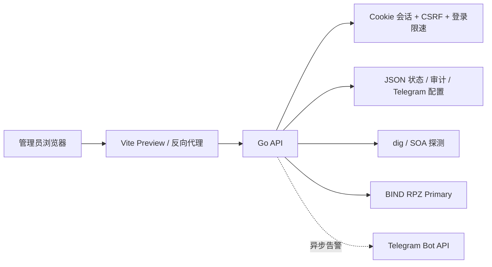

# 域盾 DNSGuard 三轮功能测试与代码审计报告

> 审计日期：2026-11-03
> 审计基线：`f0c87c0 fix: reuse captcha across page refreshes`
> 范围：`server/`、`src/`、`scripts/`、`.env.example`、`README.md`、`package.json`
> 环境：本机 API `127.0.0.1:8080`、Web `127.0.0.1:5173`、BIND 实验室 Primary `127.0.0.2:5353`、Secondary `127.0.0.3:5353` 和 `127.0.0.4:5353`
> Flavor：`null`，普通 Web/API 源码审计，不涉及外部目标或恶意样本。

## 1. 执行摘要

本次对域盾 DNSGuard 完成了三轮完整功能验证和白盒代码审计。三轮中前端构建、Go 单元测试、Race 检测、`go vet`、Shell 语法检查和 BIND/RPZ 端到端测试均通过，每轮功能测试均为 11/11。运行时检查确认未认证访问管理 API 返回 401，健康检查为 `ok`，前端标题和静态页面可正常访问。

审计没有发现当前认证边界被直接绕过的问题，也没有发现 React 的 `dangerouslySetInnerHTML`、`eval` 或 Shell 拼接执行。仍发现若干需要处理的工程风险：Node 依赖审计报告 2 个 high 级别结果；启动脚本在 Web 端口冲突时可能仍输出“启动成功”；Telegram 操作告警按事件类型冷却，可能丢失同类 RPZ 操作；HTTP 服务缺少完整连接超时；开发模式仍保留固定 HMAC Secret 回退。

结论：**功能测试通过；生产上线前建议优先处理依赖升级和启动脚本失败可见性，再处理 Telegram 告警可靠性与 HTTP 超时加固。**

## 2. 范围、信任边界与限制

### 2.1 信任边界



重点资产：认证会话、CSRF、RPZ 规则和发布任务、BIND 节点配置、TSIG/Telegram 配置文件、审计链。

### 2.2 限制

- 仅测试本机域盾 DNSGuard 和本地 BIND 实验室，没有访问外部生产主机。
- 没有真实 Telegram Bot Token，因此 Telegram 发送使用 Mock API 单元测试，未验证真实第三方投递。
- Semgrep、gosec、staticcheck、govulncheck 未安装，未产生这些工具的扫描结论。
- `npm audit` 使用官方 npm registry 完成；默认 npm 镜像的 audit endpoint 返回 404，因此镜像结果不作为漏洞结论。

## 3. 三轮测试记录

每轮均执行以下静态、构建和功能步骤；功能测试期间临时关闭认证，脚本结束后恢复 `.env` 并重启服务。

```bash
bash -n scripts/*.sh
npm run build
(cd server && go test ./... -count=1)
(cd server && go test -race ./... -count=1)
(cd server && go vet ./...)
git diff --check
./scripts/test-functional.sh
```

| 轮次 | 静态/构建 | BIND/RPZ 功能 | 认证恢复 | 结果 |
|---:|---|---|---|---|
| 1 | 全部通过 | 11/11 | `/api/auth/me` 返回 401 | 通过 |
| 2 | 全部通过 | 11/11 | `/api/auth/me` 返回 401 | 通过 |
| 3 | 全部通过 | 11/11 | `/api/auth/me` 返回 401 | 通过 |

每轮功能测试覆盖：API 健康、系统设置、认证状态、真实 DNS 节点和 Serial、节点配置持久化、RPZ 命中计数、规则创建、精确/泛域名发布、删除后待发布状态、再次发布、批量删除和发布任务。

## 4. 运行时安全验证

| 检查 | 结果 |
|---|---|
| `GET /api/health` | 200，`status=ok` |
| 未认证 `GET /api/dns/overview` | 401 |
| 未认证 `GET /api/settings/telegram` | 401 |
| 未认证 `GET /api/audit` | 401 |
| 未认证 `POST /api/dns/rpz` | 401 |
| `GET /api/settings` | 200，仅返回标题和副标题 |
| `GET /api/auth/me` | 401，`authenticated=false` |
| `scripts/check-dns-ops.sh` | 成功，3/3 DNS 节点健康，状态 `ok` |
| Web 首页 | 200，标题为“域盾 DNSGuard” |
| CAPTCHA 接口 | 重启后返回 200；超过限速时返回 429 并带 `Retry-After` |

## 5. 审计发现

### F-001：Node 依赖存在 npm audit high 结果

- 严重性：High（供应链待升级；具体运行时可利用性需结合部署模式复核）
- 置信度：High
- 位置：`package.json:7`、`package-lock.json`
- 证据：`npm audit --omit=dev --audit-level=moderate --registry=https://registry.npmjs.org`

`npm audit` 报告：

- `source-map-js 1.2.1`：event-loop denial-of-service advisory；
- `vite 8.2.2`：多个 high advisory，修复版本提示为 `8.3.5`；当前 Vite 被列在 `dependencies`，生产启动脚本使用 `vite preview`。

部分 Vite advisory 针对开发服务器或 Windows 编辑器路径，Linux `preview` 模式的直接影响需要单独确认，但当前依赖版本仍不应长期保留。

**建议**：升级 Vite、React 插件和锁文件到已修复兼容版本；升级后重新执行三轮构建、功能测试和 `npm audit`。如果生产改用 Nginx 静态托管，可将 Vite 相关工具移入开发依赖，减少运行时依赖面。

### F-002：Web 启动失败时脚本可能误报成功

- 严重性：Medium
- 置信度：High
- 位置：`scripts/start-dns-ops.sh:77-92`
- 证据：脚本使用 `setsid ... &` 后立即写入 PID 并打印成功，没有等待端口可用或检查子进程退出状态。

本轮重启时曾遇到 5173 端口被同项目旧进程占用，`.run/web.log` 记录 `Port 5173 is already in use`，但启动脚本仍打印了 Web 地址并留下失效 PID。清理同项目旧进程后重新启动才恢复正常。

**影响**：部署或升级时可能出现“脚本显示成功、实际 Web 没有由本次启动托管”的状态，运维容易误判。

**建议**：启动后轮询 Web `/` 和 API `/api/health`；任一检查失败则退出非零并清理 PID；记录实际子进程 PID/进程组；端口被占用时明确报错。

### F-003：RPZ 操作告警按事件类型冷却，可能合并掉不同操作

- 严重性：Medium
- 置信度：High
- 位置：`server/telegram.go:283-295, 321-327`
- 证据：`telegramLastAlerts` 使用 `cooldownKey=event`；默认冷却 300 秒。

例如连续新增两条不同域名规则时，两条告警都属于 `rpz_rule_create`，第二条会在冷却时间内被抑制。编辑、删除和节点类事件也有相同特征。该策略可以降低噪声，但与“看到 RPZ 操作”的预期不完全一致。

**建议**：将告警策略拆成“每条操作必发”和“异常事件聚合”两类；RPZ 新增/编辑/删除可以按规则 ID 或短时间窗口批量汇总，发布失败和节点异常继续按事件冷却。

### F-004：Telegram 投递失败也会消耗冷却时间

- 严重性：Low
- 置信度：High
- 位置：`server/telegram.go:287-295`
- 证据：网络请求执行前即写入 `telegramLastAlerts[cooldownKey]`；发送失败时没有删除或回滚时间戳。

当 Telegram API 暂时不可用时，同类告警可能在 300 秒内不再重试，降低告警可靠性。

**建议**：仅在 HTTP 200 且 Telegram 返回 `ok=true` 后记录冷却时间；失败使用指数退避或单独记录告警投递失败。

### F-005：HTTP Server 缺少完整读写和空闲超时

- 严重性：Low
- 置信度：High
- 位置：`server/main.go:90`
- 证据：`http.Server` 只设置了 `ReadHeaderTimeout`，没有 `ReadTimeout`、`WriteTimeout`、`IdleTimeout`。

`MaxBytesReader` 能限制请求体大小，但不能覆盖慢速上传、慢速响应和长期空闲连接场景。若 API 直接暴露或反向代理保护不充分，连接资源可能被不必要地占用。

**建议**：按部署环境设置完整超时，并在 Nginx/systemd 层同步配置连接和响应超时。

### F-006：开发模式保留固定 HMAC Secret 回退

- 严重性：Low（生产配置缺失时会被校验拦截）
- 置信度：High
- 位置：`server/auth.go:58-61`、`server/main.go:101-106`
- 证据：`authSecret()` 在 `AUTH_SECRET` 为空时返回固定字符串；生产校验会拒绝空 Secret，但开发模式不会。

当前默认服务配置启用认证且 `.env` 提供随机 Secret，因此本地运行正常；但手工以开发模式暴露服务并配置了认证文件时，会使用固定会话签名 Secret。

**建议**：删除固定回退；除明确的测试标志外，缺少 `AUTH_SECRET` 直接拒绝启动。测试用例使用临时 Secret。

## 6. 正向控制与未发现问题

- 三轮未认证管理 API 均被 401 拒绝。
- 认证开启时非 GET 请求要求 CSRF Token；请求体限制为 1 MiB。
- 生产校验包含认证开关、随机 Secret、bcrypt 认证文件、监控 Token、TLS/可信代理和运行文件预检。
- DNS 节点地址使用允许网段/主机白名单。
- RPZ 发布使用 `exec.CommandContext` 和超时，没有发现 Shell 拼接执行。
- 状态、节点配置、审计和 Telegram 配置使用临时文件、同步和原子替换；敏感 Telegram 配置文件自动使用 0600。
- React 页面未发现 `dangerouslySetInnerHTML`、`innerHTML` 或 `eval`。
- 审计日志包含哈希链、搜索和轮转能力。
- CAPTCHA 有容量上限、按 IP 限速、`no-store`，前端刷新会复用有效验证码。

## 7. Evidence → Finding → Path

| Evidence | 证据 | 关联 Finding |
|---|---|---|
| E-001 | 三轮 `npm run build`、Go test、Race、Vet、Shell 语法和 `git diff --check` 均通过 | F-001–F-006 的总体验证基础 |
| E-002 | 三轮 `scripts/test-functional.sh` 均输出 `Functional tests passed: 11` | 功能回归通过 |
| E-003 | 未认证管理 API 返回 401；Web 首页 200；监控脚本返回 `status=ok` | 认证边界和运行时健康 |
| E-004 | `npm audit` 官方 registry 报告 Vite/source-map-js 两项 high | F-001 |
| E-005 | 5173 端口冲突时 `.run/web.log` 报错，但启动脚本仍输出成功信息 | F-002 |
| E-006 | `server/telegram.go` 冷却键和更新时间逻辑 | F-003、F-004 |
| E-007 | `server/main.go` 的 `http.Server` 初始化 | F-005 |
| E-008 | `server/auth.go` 的固定 Secret 回退与生产条件分支 | F-006 |

### Path P-001：管理操作链路

```text
管理员浏览器
  -> Cookie/CSRF 认证
  -> Go API
  -> JSON 状态文件 / RPZ 发布任务
  -> BIND Primary/Secondary
  -> 审计日志与 Telegram 告警
```

关联路径：`E-003 -> 认证边界`；`E-006 -> Telegram 告警策略`；`E-007 -> HTTP 连接资源`。

## 8. 修复优先级

1. **优先升级 Vite 和 source-map-js 依赖并重新跑三轮回归。**
2. **修复启动脚本的 Web 就绪检查和失败退出。**
3. 调整 RPZ 告警聚合策略，避免不同规则操作被静默合并。
4. 修复 Telegram 失败投递的冷却记录逻辑。
5. 设置 Go HTTP Server 完整超时。
6. 删除开发模式固定 Secret 回退。

## 9. 测试与审计结论

- 三轮功能测试：**通过，11/11 × 3**。
- 三轮 Go Race：**通过**。
- 三轮 `go vet`：**通过**。
- 三轮前端构建：**通过**。
- 运行时认证边界：**通过**。
- 依赖审计：**发现 2 个 high 结果，待升级**。
- 代码审计：**发现 6 项需要改进的问题，未发现当前直接可利用的认证绕过**。
- 工作区在生成本报告前为干净状态；报告生成后需要单独提交本报告。
